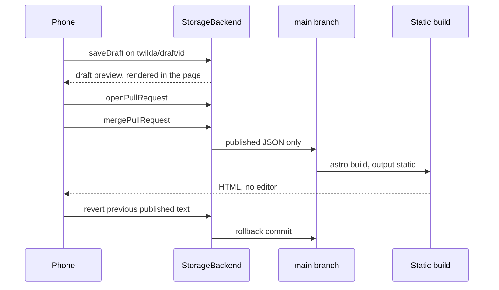

# Architecture

Contract version 1 lives in `packages/core`. The Zod schemas and `StorageBackend` methods are the shared interface. Change them only with a note in the pull request.

Two editors exist:

- `editor/` is the localhost desk. `npm run dev` binds it to `127.0.0.1:5173`. It writes `content/<id>/draft.json` and `published.json` for the Field Desk demo. Leave that pin alone.
- `apps/demo-editor` is the phone demo. It is a static page. Drafts stay in the browser. It is not part of `dist/`.

The public site never needs either editor to be online.

## Static contract

The new contract, used by the demo and by `examples/studio`, is JSON:

```text
content/articles/<slug>.json
content/pages/<slug>.json
content/data/<name>.csv
content/media/<name>.json          uploads only, as JSON bytes
content/.twilda/history/<id>/<stamp>.json
```

A document has `status: "draft"` or `"published"`. The static Astro build reads published JSON only. `loadContentTree` skips drafts. Publishing does not unpublish a live page: the previous published file is stored under `content/.twilda/history` and rollback writes that file back.

`examples/studio` builds with `output: "static"` and no adapter. Its HTML has no script tags. Chart blocks become a table plus alt text. They do not load Plotly.

Root `npm run build` still builds Field Desk from `content/*/published.json` into `dist/`. `npm run check:static` fails if that folder contains the demo editor marker `twilda-demo-editor`.

What production needs after a publish: the merged files and a normal static build. Not the editor, not IndexedDB, not a token, not a database.

## Content model

Articles are ordered blocks. Pages are ordered sections. The schema is `packages/core/src/schema.ts`. Example files are generated into `examples/studio/content/` by `npm run build:demo`.

Article blocks: `heading`, `paragraph`, `key-findings`, `chart` (`dataPath` + `alt`), `callout`, `sources`, `image` (`banner` or `figure`), `embed` (`video` or `audio`), `download`.

Page sections: `carousel` (the sample home page has 5 slides; the schema allows 1–8), `story-grid` (square cards), `menu-shelf`.

`id` and `slug` match. Links are site paths or `http(s)` URLs. `javascript:` is rejected.

The localhost desk still uses the older section list in `src/schema/sections.ts` (`pull-quote`, `headline-facts`, and so on). That file is the Field Desk contract. It is not the phone contract.

## Draft, preview, publish

Branch names:

- draft: `twilda/draft/<documentId>`
- revert: `twilda/revert/<documentId>-<stamp>`
- base: `main`

`createBranch` is idempotent. Merge applies the branch diff, so a later edit on `main` is not wiped by an older draft branch.



In the browser demo, `StorageBackend` id `demo` performs those steps in IndexedDB (localStorage if IndexedDB fails). Pull request URLs look like `demo://pull/1`. That is a real local merge. It is not GitHub.

`packages/backend-fs` writes the same state to a directory and mirrors each branch under `tree/`. `packages/backend-github` calls the GitHub REST API with a token passed in at runtime. Tests use a fake `fetch`. No GitHub App is created in this repo.

The in-editor preview renders the saved draft or the published copy. `demo-dist/preview/` is a static build of the seeded published sample. It does not update when you tap Publish. Rebuilding does.

## Phone editor

`npm run demo` serves the editor at `http://127.0.0.1:4173`. Width target is 390px.

| Screen | What it does |
| --- | --- |
| Document list | Articles and pages. Shows unpublished changes. Reset to sample. |
| Edit | Block or section fields. Touch drag handles reorder. Save draft. |
| Media | Image upload, 1.5 MB, png/jpeg/webp/gif/svg. Stored on the draft. |
| Preview | Draft preview and published preview. |
| Publish | Merge the local pull request, show history, roll back. |

There is no service worker. A manifest is included so a browser can offer Add to Home Screen. The page works without installing.

Sample articles use public titles and a few published figures from artometrics.com, fetched 2026-11-10. Bodies are short fixtures. Banners are an original SVG, not Artometrics art. See [franchise-slice.md](franchise-slice.md).

## Auth

The production site has no login. These are the editor options:

| Option | What is true | Cost in this repo | Risk |
| --- | --- | --- | --- |
| Localhost desk | Already shipped. Bound to 127.0.0.1. Writes local files. | None | Useless on a phone. |
| Browser demo | No sign-in. IndexedDB on the device. Reset clears it. | None | Not shared. A cleared browser loses drafts. Recommended for the phone demo. |
| GitHub token or device flow | The editor calls GitHub from the browser. No Twilda server. Token stays in tab memory. | A GitHub OAuth App client id Kyle creates, or a fine-grained PAT. Not committed. | XSS in the editor page can read the token. Public repos show drafts as branches. |
| A Twilda auth server | Would hold GitHub App private keys. | A server we would have to run. | Rejected for v1. The production site must stay static. |

Recommendation: use the browser demo to edit on a phone with no account. Use a fine-grained PAT or device flow only when a real repository should receive the pull request. Do not add auth to the production Astro build.

## Hosted pieces

| Piece | Needed for the phone demo? | Notes |
| --- | --- | --- |
| Editor static host | Yes, if the phone should open a URL | `demo-dist/` from `npm run build:demo`. Any static host. See [demo-hosting.md](demo-hosting.md). |
| GitHub | No for the demo. Yes for real publish. | REST from the browser. Mocked until a token exists. |
| Preview host | The demo renders preview in the page | A separate CI preview per branch is not built. Unverified. |
| Production site | Already static | Must stay a different deploy from the editor. |

No paid plan is required. Firebase Hosting has a no-cost Spark tier; current quotas were not rechecked for this note. Do not attach this repo to `twilda-510519` or `artometrics-510519`.

## Open questions and risks

Unverified items are marked.

1. The Franchise article is being rewritten. Figures in the fixture were copied from the public page on 2026-11-10 and may already be wrong. Unverified against the Quarto source, which this repo does not contain.
2. Bylines for Anime, Dodgers, and Simpsons were not in the text extracted from those public pages. The fixture says Artometrics. Simpsons uses the homepage card only. Unverified.
3. No CSP header file exists in this repo. Whether the live Twilda host sends `script-src 'none'` was not rechecked from here. The demo editor is a scripted page and must not be deployed onto that production target.
4. GitHub device flow and contents writes are tested with a fake `fetch` only. Real GitHub behavior is unverified. There is no client id in the repo.
5. A branch preview build in CI is not implemented. The phone preview is a client-side render.
6. IndexedDB quota on a phone was not measured. Uploads are rejected over 1.5 MB. A full store throws `persist-failed`.
7. The localhost desk and the phone contract are different JSON shapes. Migrating Field Desk is not done.
8. Shipping this editor onto artometrics.com is out of scope. Preview branches of that site are not created by this repo.
